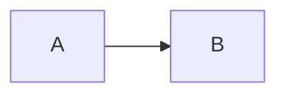

The render hooks, reached through Markdown alone. The values are those of
`data/hostile.yaml`, spelled the way Markdown needs them.

## Image Alt Text


## Image Title

</script>")


## Image URL

)

)

)


## Link Title

[Link](https://example.com "\"><script>alert(1)</script>")

[Link](https://example.com 'C:\\path\\"; $1 %s')

## Link URL

[Link](javascript:alert(11))

[Link](JaVaSCript:alert(12))

[Link](jav&#x09;ascript:alert(13))

[Link](https://example.com/"onmouseover="alert(16))

[Link](https://example.com/?a=1&copy=2&lt=3&not=4&amp;b=5)

[Link](https://example.com/$1/?q=${1})

## Blockquote

The author and the source are Markdown and may hold HTML, so only quotes go
there.

> Quoted
{author="' onfocus=alert(2) autofocus x='" href="javascript:alert(11)"}

> Quoted
{author="C:\\path\\\";alert(6);//" href="https://example.com/?a=1&copy=2&lt=3&not=4"}

## Alert

> [!note]
> A hint and a color from block attributes.
{hint="\"><script>alert(1)</script>" color="red\" onclick=\"alert(22)"}

## Code Block

```go {data-value="\"><script>alert(1)</script>" class="x\" onclick=\"alert(2)"}
x := 1
```

A code block's attributes end at the first closing brace, so the value here
goes without `${1}` and `{0}`.

```go {data-value="$1 $$ %s %d %n"}
x := 2
```

## Mermaid



## Math

```math {data-value="\"><script>alert(1)</script>"}
x^2
```

## Table

| Cell |
| ---- |
| Text |
{data-value="\"><script>alert(1)</script>" class="x\" onclick=\"alert(2)"}
